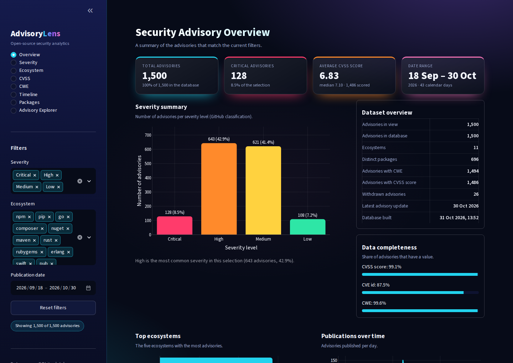
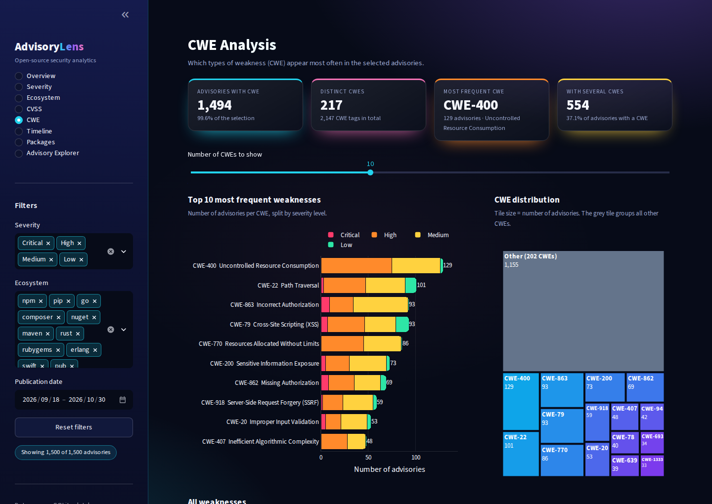
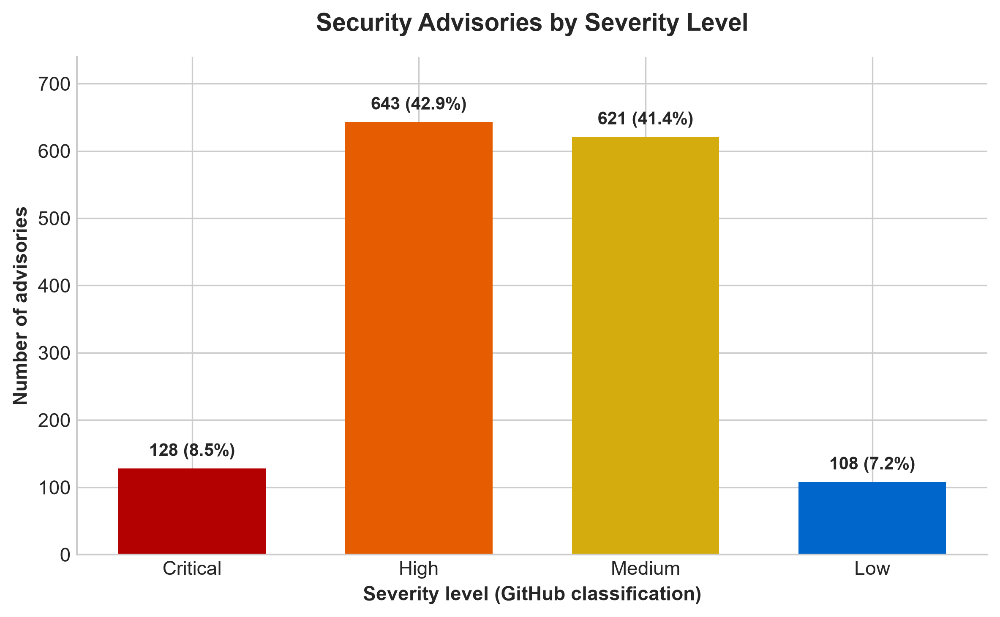
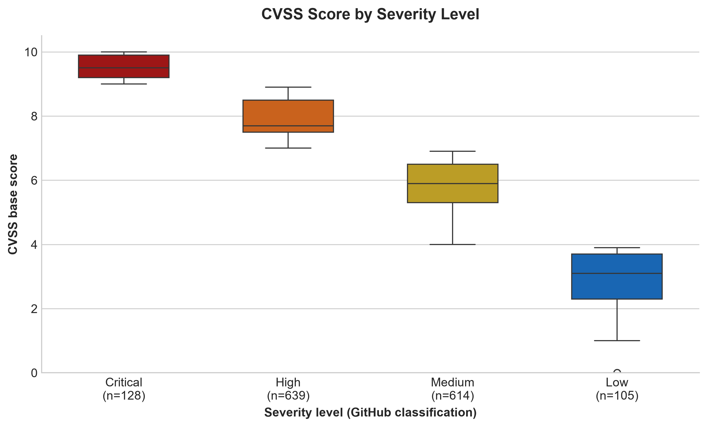
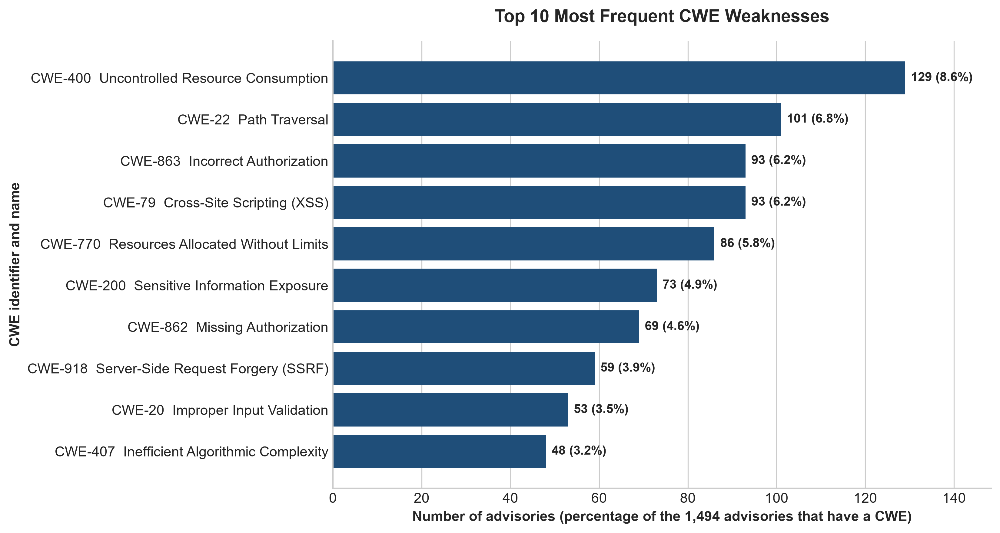
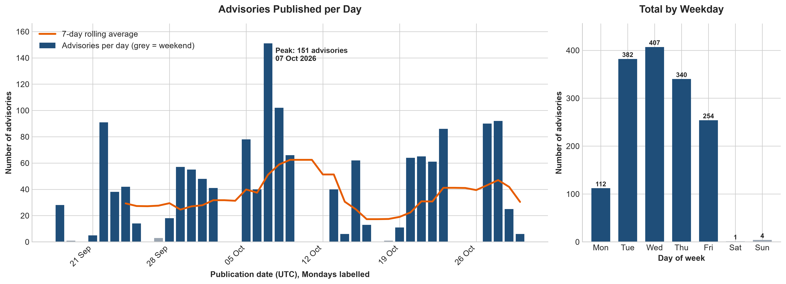

# AdvisoryLens

**An ETL & EDA Pipeline for Open-Source Security Advisories**

AdvisoryLens collects security advisories for open-source packages from the GitHub Global Security Advisories API,
cleans and validates them, stores them in a SQLite database, analyses them with a structured Exploratory Data
Analysis (EDA) and presents the results in an interactive Streamlit dashboard.

**Authors:** Ammara Naveed, Sadia Shafiq, Afia Sajal

[](https://advisorylens.streamlit.app/)

**Live dashboard:** <https://advisorylens.streamlit.app/>
*(Hosted on the free Streamlit Community Cloud. If nobody has used it for a while, the app goes to sleep:
open the link and press the wake-up button, it starts again in about a minute.)*

---

## Table of Contents

1. [Project Overview](#1-project-overview)
2. [Why This Dataset?](#2-why-this-dataset)
3. [Pipeline Architecture](#3-pipeline-architecture)
4. [Technology Stack](#4-technology-stack)
5. [Project Structure](#5-project-structure)
6. [Dataset Description](#6-dataset-description)
7. [Data Quality Decisions](#7-data-quality-decisions)
8. [Getting Started](#8-getting-started)
9. [Usage](#9-usage)
10. [Interactive Dashboard](#10-interactive-dashboard)
11. [Testing](#11-testing)
12. [EDA Results](#12-eda-results)
13. [Limitations](#13-limitations)
14. [Future Work](#14-future-work)
15. [Data Source](#15-data-source)

---

## 1. Project Overview

Almost every modern application depends on open-source packages (npm, pip, Go modules, Maven, ...). A single
vulnerability in a popular package can affect thousands of projects, so understanding *which* weaknesses are reported,
*how severe* they are and *where* they occur is valuable for developers and security teams.

This project builds a complete data pipeline and analysis for this problem:

| Stage | Description |
|---|---|
| **Extract** | Downloads the 1,500 most recently published reviewed advisories from the GitHub REST API |
| **Transform** | Flattens the JSON with `pandas`, keeps CVSS v3 and v4 scores, handles missing values, removes duplicates |
| **Validate** | Checks every record against a strict `Pydantic` schema before loading |
| **Load** | Stores the validated records in a SQLite database with a primary key and constraints |
| **Analyse** | Notebook (`notebooks/eda.ipynb`) and script (`src/eda.py`) with charts and findings |
| **Explore** | Interactive dashboard (`app.py`, Streamlit + Plotly) with filters, charts and a searchable data explorer |

**Research questions answered by the EDA**

1. How complete and reliable is the dataset?
2. How are advisories distributed across severity levels?
3. Which ecosystems are affected most, and does severity differ between them?
4. How are CVSS scores distributed, and how do they relate to the severity label?
5. Which weakness types (CWE) occur most often?
6. When are advisories published?
7. Which packages are affected most often?

## 2. Why This Dataset?

- **Real and current:** the GitHub Advisory Database is one of the main public sources of vulnerability information
  for open-source software.
- **Accessible:** it is available through a public REST API with pagination, so no scraping or login is required.
- **Rich structure:** each advisory contains nested JSON (packages, ecosystems, CWE lists, CVSS vectors), which makes
  the transformation and validation steps meaningful.
- **Good for EDA:** it has categorical (severity, ecosystem, CWE), numeric (CVSS), temporal (publication date) and
  text fields, and it contains real data-quality challenges (missing scores, multi-value fields).

**Loading destination: SQLite.** SQLite needs no server, stores everything in one file, supports SQL constraints
(primary key, `CHECK` rules) and is supported by Python out of the box, so the project is easy to run on any computer.

## 3. Pipeline Architecture

```
 GitHub Advisories API
          |
          v
   [1] EXTRACT   (src/extract.py)     ->  data/raw/raw_advisories.json
          |
          v
   [2] TRANSFORM (src/transform.py)   ->  data/processed/processed_advisories.csv
          |
          v
   [3] VALIDATE  (src/validate.py)    ->  invalid rows go to data/processed/rejected_records.csv
          |
          v
   [4] LOAD      (src/load.py)        ->  database/advisories.db  (table: advisories)
          |
          v
   [5] EDA       (notebooks/eda.ipynb, src/eda.py)  ->  outputs/visualizations/*.png
          |
          v
   [6] DASHBOARD (app.py)             ->  reads database/advisories.db (read-only)
```

`pipeline.py` runs stages 1 to 4. Validation runs **before** loading, so only valid rows reach the database.

## 4. Technology Stack

| Purpose | Library |
|---|---|
| HTTP requests | `requests` |
| Data cleaning and analysis | `pandas`, `numpy` |
| Schema validation | `pydantic` (v2) |
| Database | `sqlite3` (Python standard library) |
| Visualisation (notebook and script) | `matplotlib`, `seaborn` |
| Interactive dashboard | `streamlit`, `plotly` |
| Notebook | `jupyterlab` |
| Testing | `pytest` |

Exact versions are pinned in `requirements.txt`.

## 5. Project Structure

```
AdvisoryLens/
|-- app.py                       # Streamlit dashboard
|-- pipeline.py                  # runs Extract -> Transform -> Validate -> Load
|-- requirements.txt             # pinned dependencies
|-- README.md
|-- .gitignore
|-- .streamlit/
|   `-- config.toml              # dashboard theme
|-- src/
|   |-- extract.py               # GitHub API download with pagination
|   |-- transform.py             # pandas cleaning, CVSS v3/v4 handling
|   |-- validate.py              # Pydantic schema and rejected-record report
|   |-- load.py                  # SQLite table with primary key and constraints
|   |-- eda.py                   # reusable EDA script (same analysis as the notebook)
|   `-- inspect_data.py          # quick helper to look at the processed data
|-- notebooks/
|   `-- eda.ipynb                # full EDA with interpretation
|-- tests/
|   |-- test_pipeline.py         # offline unit tests for the ETL pipeline
|   `-- test_dashboard.py        # tests for the dashboard (read-only access to the database)
|-- docs/
|   `-- screenshots/             # dashboard screenshots used in this README
|-- data/
|   |-- raw/raw_advisories.json
|   `-- processed/processed_advisories.csv
|-- database/
|   `-- advisories.db
`-- outputs/
    `-- visualizations/          # charts created by the notebook and by src/eda.py
```

## 6. Dataset Description

The table `advisories` contains **1,500 records and 14 columns**.

| Column | Type | Description |
|---|---|---|
| `ghsa_id` | TEXT (primary key) | Unique GitHub advisory id |
| `cve_id` | TEXT | CVE id, if one was assigned |
| `summary` | TEXT | Short description of the vulnerability |
| `severity` | TEXT | `low`, `medium`, `high` or `critical` |
| `cvss_score` | REAL | Preferred CVSS score: v4 if available, otherwise v3 |
| `cvss_version` | TEXT | `4.0` or `3.x` (the version of `cvss_score`) |
| `cvss_v3_score` | REAL | CVSS v3 score, if available |
| `cvss_v4_score` | REAL | CVSS v4 score, if available |
| `published_at` | TEXT (ISO 8601, UTC) | Publication timestamp |
| `updated_at` | TEXT (ISO 8601, UTC) | Last update timestamp |
| `is_withdrawn` | INTEGER (0/1) | 1 if GitHub has withdrawn the advisory |
| `cwe_ids` | TEXT | One or more CWE ids, comma separated |
| `ecosystem` | TEXT | One or more ecosystems (npm, pip, go, ...), comma separated |
| `package_name` | TEXT | One or more affected packages, comma separated |

**Time window:** the API returns advisories newest first, so the dataset contains the latest 1,500 reviewed
advisories, published between **18 Sep 2026 and 30 Oct 2026** (43 days).

## 7. Data Quality Decisions

| Problem | Decision |
|---|---|
| Missing CVSS score | Stored as missing (`NULL`), **never replaced by 0.0**. A zero would be read as "no risk" and would pull the average score down. |
| Two CVSS versions | Both v3 and v4 scores are extracted. GitHub's severity label follows v4 when it exists, so `cvss_score` prefers v4. |
| Multi-value fields (ecosystem, package, CWE) | Stored as sorted, comma-separated text (reproducible), and split before counting in the analysis so nothing is double counted. |
| Missing CVE / CWE | Stored as empty values (`NULL`), not as the text `"N/A"`. |
| Duplicates | Removed by `ghsa_id` (none were found in this dataset). |
| Withdrawn advisories | Kept and flagged with `is_withdrawn` (26 records, 1.7%). |
| Invalid records | Rejected by the Pydantic schema and written to `rejected_records.csv`. They are never loaded. |
| Database integrity | Explicit schema with `PRIMARY KEY`, `CHECK` constraints and indexes; the load runs in one transaction and the row count is verified. |

## 8. Getting Started

**Requirements:** Python 3.11 or newer.

```powershell
# 1. Open a terminal in the project folder
cd AdvisoryLens

# 2. Create and activate a virtual environment (Windows PowerShell)
python -m venv venv
venv\Scripts\activate

# 3. Install the dependencies
pip install -r requirements.txt
```

On macOS / Linux, activate the environment with `source venv/bin/activate`.

No API token is needed: the project makes about 15 requests to the public GitHub API, which is within the limit for
unauthenticated requests.

## 9. Usage

All commands are run from the project root folder.

**Run the ETL pipeline**

```powershell
python pipeline.py             # uses the saved raw file (downloads only if it is missing)
python pipeline.py --refresh   # downloads fresh data from GitHub (the dataset will change!)
```

**Run the EDA script** (prints the analysis and saves 9 charts)

```powershell
python src/eda.py
```

**Start the dashboard**

```powershell
streamlit run app.py
```

The dashboard opens in your browser (`http://localhost:8501`). Press `Ctrl + C` in the terminal to stop it.
A hosted copy is available at <https://advisorylens.streamlit.app/>; it is redeployed automatically whenever the
`main` branch of this repository changes.

**Open the notebook** (analysis with explanations)

```powershell
jupyter lab
```

Open `notebooks/eda.ipynb` and choose **Kernel > Restart Kernel and Run All Cells**.

All charts are saved in `outputs/visualizations/`.

## 10. Interactive Dashboard

`app.py` turns the results of the ETL and EDA work into an interactive security analytics dashboard. It is an
additional layer: it only **reads** the existing SQLite database (opened in read-only mode) and does not change the
ETL pipeline, the database, the notebook or `src/eda.py`. The numbers in the dashboard are the same as in the notebook.

**Try it online: <https://advisorylens.streamlit.app/>** (or run it yourself, see [Usage](#9-usage)).



| Page | What it shows |
|---|---|
| **Overview** | KPI cards (total, critical, average CVSS, date range), severity summary, dataset overview, data completeness, top ecosystems, publications over time |
| **Severity** | Count and share per severity level (bar chart, donut chart) and a comparison table |
| **Ecosystem** | Advisories per ecosystem, severity mix per ecosystem (with an adjustable minimum size), comparison table |
| **CVSS** | Score distribution coloured by severity band, box plot per severity, statistics by severity and CVSS version |
| **CWE** | Most frequent weaknesses split by severity, treemap of the distribution, full CWE table (multi-CWE advisories are counted correctly) |
| **Timeline** | Daily publications with a 7-day average, weekday pattern, monthly view with the covered days |
| **Packages** | Most affected packages coloured by ecosystem, ecosystem and package comparison (no double counting) |
| **Advisory Explorer** | Search (advisory id, CVE id, package, ecosystem, CWE, summary), sorting, advisory details card and **CSV download** of the filtered records |



**Filters.** The sidebar filters (severity, ecosystem, publication date range) apply to every page, KPI card, chart and
table. *Reset filters* restores the full selection, and helpful messages appear when no advisory matches.

**Design and technical notes**

- Dark "Neon Aurora" theme (`.streamlit/config.toml` plus a small amount of custom CSS), a responsive layout and
  interactive Plotly charts with hover information.
- Lively interface: bars grow, areas rise, the donut spins in and treemap tiles pop in whenever a page opens **and every
  time a filter changes**; KPI cards slide up and lift on hover. This is done with CSS only. The *Animations* switch in
  the sidebar turns it off, and it is skipped automatically for users who prefer reduced motion.
- Data is loaded once and cached; the cache refreshes automatically when the database file changes.
- Missing CVSS scores are excluded from score statistics, never counted as 0. Ecosystem, package and CWE values are split
  before counting, exactly as in the notebook.
- The dashboard describes a short time window (see [Limitations](#13-limitations)); it does not show long-term trends.

## 11. Testing

```powershell
python -m pytest -v
```

- `tests/test_pipeline.py` is completely offline: it uses temporary folders and fake data, and it never calls the GitHub
  API or touches the real data and database files. It covers the CVSS handling, duplicate removal, deterministic joins,
  validation rules, the SQLite schema and the pagination logic of the extractor.
- `tests/test_dashboard.py` runs the real dashboard with Streamlit's `AppTest` (no browser needed). It opens every page,
  checks the KPI numbers and filters against the database, tests the explorer search and the CSV export. It only reads
  the database.

## 12. EDA Results

The numbers below come from the final analysis of the 1,500 advisories.

| Area | Main finding |
|---|---|
| **Data quality** | No duplicates; only 14 advisories (0.9%) have no CVSS score; 188 (12.5%) have no CVE id |
| **Severity** | High (42.9%) and medium (41.4%) dominate; critical is 8.5% (128 advisories); low is 7.2% |
| **Ecosystems** | npm (572), pip (454) and Go (244) cover 84.4% of all advisories |
| **CVSS** | Mean 6.83, median 7.10 (n = 1,486); each severity level is a separate CVSS band (critical 9.0-10.0, high 7.0-8.9, medium 4.0-6.9, low 0.0-3.9) |
| **CWE** | CWE-400 (Uncontrolled Resource Consumption) is the most frequent with 129 advisories, followed by CWE-22 and CWE-863; critical advisories are led by CWE-94 (Code Injection) and CWE-78 (OS Command Injection) |
| **Time** | 99.7% of advisories were published on weekdays; the busiest day was 07 Oct 2026 with 151 advisories |
| **Packages** | 696 distinct packages; 58.2% have only one advisory; the top ten make up only 12.7% of all package-advisory pairs |

**Selected charts**

| Severity | CVSS by severity |
|---|---|
|  |  |

| Top CWE weaknesses | Publication timeline |
|---|---|
|  |  |

More charts (`ecosystem_analysis.png`, `ecosystem_severity.png`, `cvss_distribution.png`, `package_analysis.png`,
`data_quality.png`) are in `outputs/visualizations/`.

## 13. Limitations

- **Short time window:** the data is the latest 1,500 reviewed advisories (about six weeks), not a random sample of
  history. The analysis can describe this period, but it cannot show long-term trends or seasonality.
- **Counts are not risk:** the numbers describe advisories, not exploitation, package popularity or real-world damage.
- **No normalisation:** ecosystem and package counts are not divided by the size or popularity of the ecosystem or
  package, so they cannot rank how "secure" an ecosystem is.
- **Mixed CVSS versions:** CVSS v3 and v4 are different scoring systems and are combined in `cvss_score`.
- **Withdrawn advisories** (1.7%) are kept and flagged.
- **Reviewed advisories only:** unreviewed advisories are not part of the dataset.
- **Small groups:** ecosystems with few advisories (for example NuGet and Rust) have unstable percentages.
- **Refreshing the data:** `python pipeline.py --refresh` downloads the *newest* 1,500 advisories, so all numbers (and the
  numbers quoted in the notebook text and in this README) will change. If the download stops half way (internet problem or
  API rate limit), the pipeline stops with an error and keeps the existing raw file; run `--refresh` only with a stable
  connection.

## 14. Future Work

- Collect a longer time range (for example with date-filtered API requests) to study trends over months or years.
- Normalise counts using package download statistics.
- Add scheduled refreshes of the pipeline.
- Deploy the dashboard so it can be used without installing Python.

## 15. Data Source

Advisory data comes from the **GitHub Global Security Advisories** (GitHub Advisory Database) REST API:
<https://docs.github.com/en/rest/security-advisories/global-advisories>. Please check GitHub's terms and the license
of the Advisory Database before reusing the data.